# Introductie WordPress
## Steven Speek

----

# Leerdoelen

- Een eigen domein opzetten
- [WordPress beginners cursus](https://learn.wordpress.org/course/beginner-wordpress-user/) kunnen volgen
- Iets op te zoeken met [Gemini AI](https://gemini.google.com/)

----

# Praktisch

- Bladwijzers en wachtwoorden sla je op in je Google account, door je aan te melden
in Google Chrome

- Om je AI-zoekopdrachten bewaar je door Gemini ingelogd te gebruiken

---

# Gemini AI

----

## Oefening

- Open Google Chrome: Druk <kbd><kbd><svg class="win-icon" xmlns="http://www.w3.org/2000/svg" viewBox="0 0 88 88" width="11" height="11"><path d="M0 12.402l35.687-4.86.016 34.423-35.67.203zm35.67 33.529l.028 34.453L.028 75.48.026 45.7zm4.326-39.025L87.314 0v41.527l-47.318.376zm47.329 39.349l-.011 41.34-47.318-6.678-.066-34.739z" fill="currentColor"/></svg></kbd></kbd> in en laat weer los, type `chro` en druk <kbd><kbd>Enter</kbd></kbd>
- Ga naar [Gemini AI](https://gemini.google.com)
    - <kbd><kbd>Ctrl</kbd>+<kbd>L</kbd></kbd>
    - type `gemini.google.com`

----

## Oefening

- Meld je aan in [Gemini AI](https://gemini.google.com)
- Vraag:
```
Hoe meld ik mij aan in Google Chrome
```
- Voer de instructies uit

<!-- ----

## Oefening

- Vraag aan [Gemini AI](https://gemini.google.com)
```
Hoe zorg ik ervoor dat ik Google Chrome
kan openen met WIN+1 onder MS Windows
```
- Voer de instructies uit
- Test of <kbd><kbd><svg class="win-icon" xmlns="http://www.w3.org/2000/svg" viewBox="0 0 88 88" width="11" height="11"><path d="M0 12.402l35.687-4.86.016 34.423-35.67.203zm35.67 33.529l.028 34.453L.028 75.48.026 45.7zm4.326-39.025L87.314 0v41.527l-47.318.376zm47.329 39.349l-.011 41.34-47.318-6.678-.066-34.739z" fill="currentColor"/></svg></kbd>+<kbd>1</kbd></kbd> Google Chrome opent -->

----

<!-- ## Deze presentatie


`slspeek.github.io/intro-wordpress`

---- -->

## Oefening

Maak een bladwijzer van de cursus
- In Google Chrome druk je <kbd><kbd>Ctrl</kbd>+<kbd>L</kbd></kbd>
- Type 

`slspeek.github.io/intro-wordpress`

 en <kbd><kbd>Enter</kbd></kbd>
- Druk <kbd><kbd>Ctrl</kbd>+<kbd>D</kbd></kbd>

----

## Oefening

Maak een bladwijzer van [Gemini AI](https://gemini.google.com).

```
https://gemini.google.com
```

----

## Oefening

- Ga naar Gemini via je bladwijzer
- Vraag:
```
Hoe maak ik een mapje "cursus" op
de bladwijzerbalk in Google Chrome
```
- Voer de instructies uit
- Verplaats de bladwijzers naar dat mapje

----

## Oefening

- Ga naar [Gemini AI](https://gemini.google.com)
- Maak een nieuw `Notebook` aan onder de naam `WordPress cursus`
- Voeg aan de bronnen:
```
https://learn.wordpress.org
```
onder `Websites toevoegen` toe

`WordPress` onder `Gekopieerde tekst` toe en

`Met gebruik van een Block Theme` onder `Gekopieerde tekst` toe

----

## Oefening

Stel nu notebook `WordPress cursus` de vraag:
```
wat is het verschil tussen
een post en een page
```

---

# Wat is [WordPress](https://wordpress.org)?

- Wat kun je ermee bouwen?

----

## WordPress 

- WordPress is een open source contentmanagementsysteem
- Het wordt gebruikt voor websites, blogs, webwinkels en meer
- Inhoud en vormgeving worden afzonderlijk beheerd

----

## Oefening 

Schrijf je in op [learn.wordpress.org](https://login.wordpress.org/register)

----

## Oefening

1. Ga naar [Beginner WordPress User](https://learn.wordpress.org/course/beginner-wordpress-user/)
1. Maak daar een bladwijzer van in het "cursus" mapje
1. Volg de eerste les `Introduction to WordPress`

---

# Overzicht beheer

- Hoe bereik je het beheer
- SSL-certificaat maken
- Installatie

<!-- Later in de cursus:

- Back-up
- Verwijdering -->

---

# Naar het beheer

Ga met je browser naar

`<mijn naam>.designcodelab.org:2222/`

----

## Inloggen

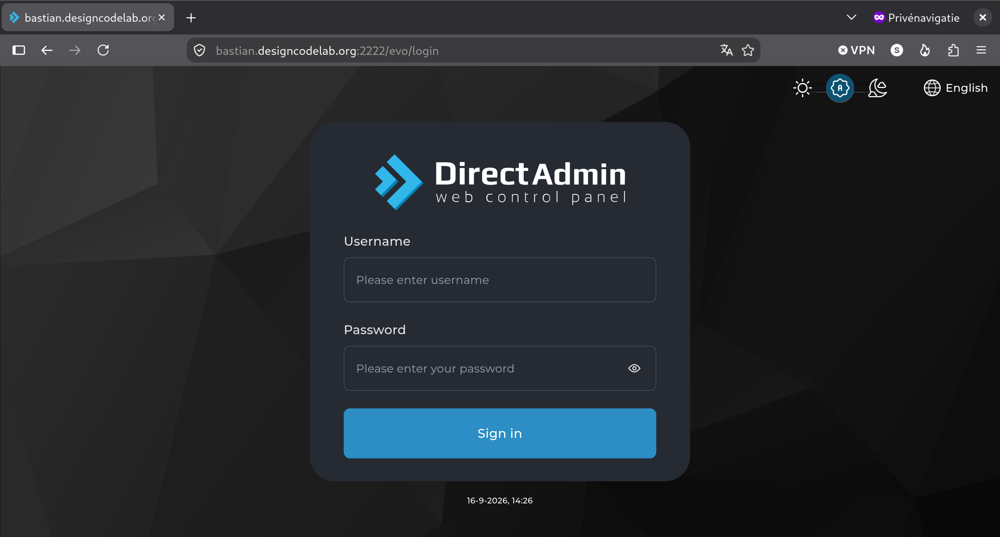

----

## DirectAdmin homepage

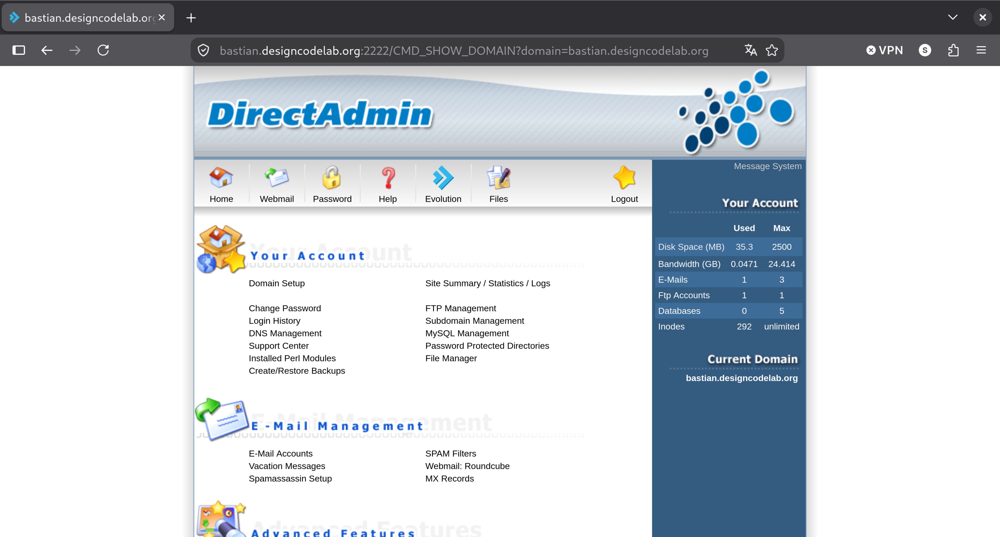

----

## Verder naar Evolution

Klik op

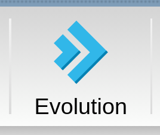

----

## Evolution scherm

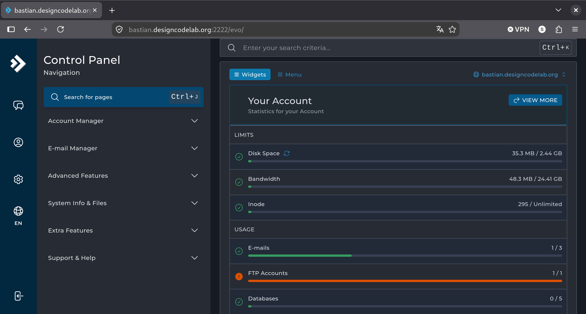

----

## Naar WordPress Manager

Druk op <kbd><kbd>Ctrl</kbd>+<kbd>J</kbd></kbd>, en type `Wordpress`

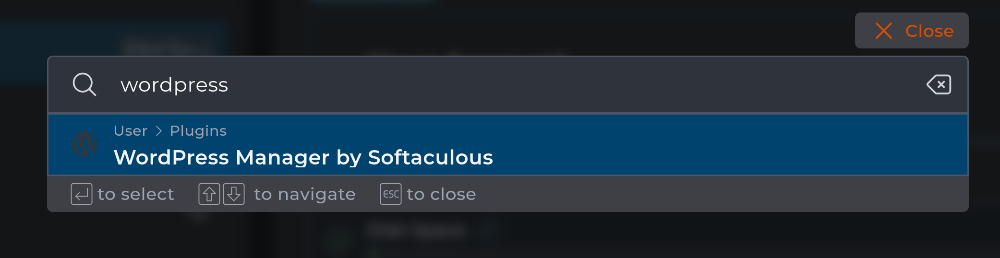

Druk op `ENTER`

----

## WordPress Manager

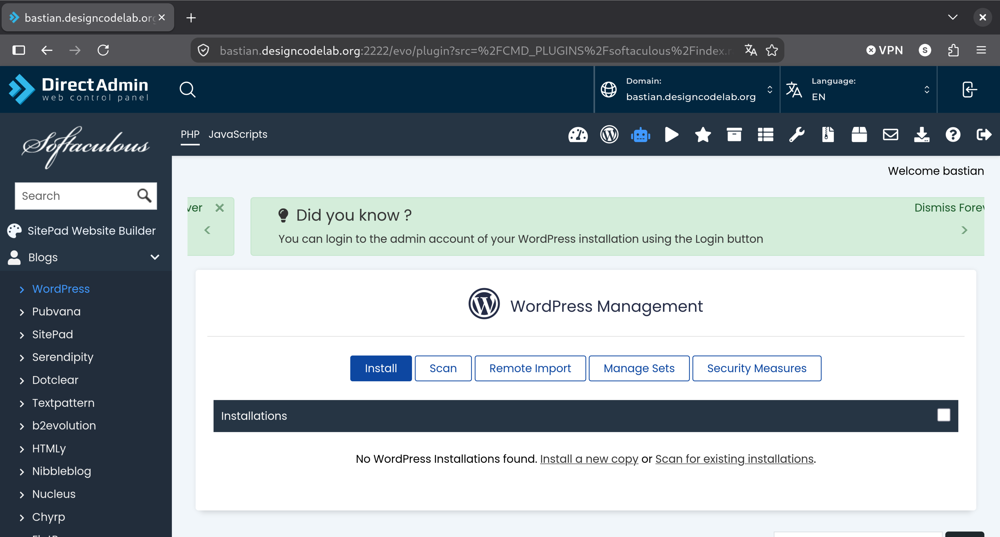

----

## Bewaar dit adres

Maak hier een bladwijzer van met <kbd><kbd>Ctrl</kbd>+<kbd>D</kbd></kbd>, deel de bladwijzer in het mapje cursus,
nadat je het de naam `WordPress manager` hebt gegeven

---

# SSL-certificaat maken

Om WordPress veilig te kunnen draaien heb je een SSL-certificaat nodig

----

## Ga naar DirectAdmin

`<mijn naam>.designcodelab.org:2222/`

----

## DirectAdmin homepage


----

## Ga naar SSL-Certificates

Klik op `SSL-Certificates` onder `Advanced Features`

----

## SSL-Certificates

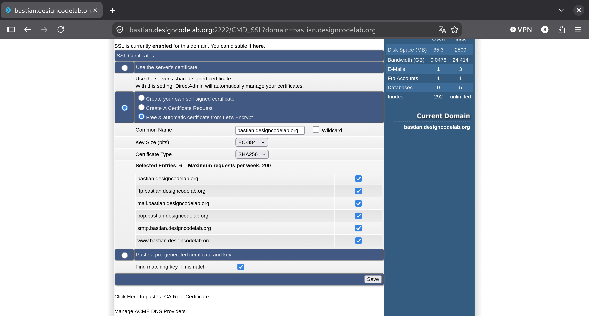

----

## SSL-Certificates gelukt

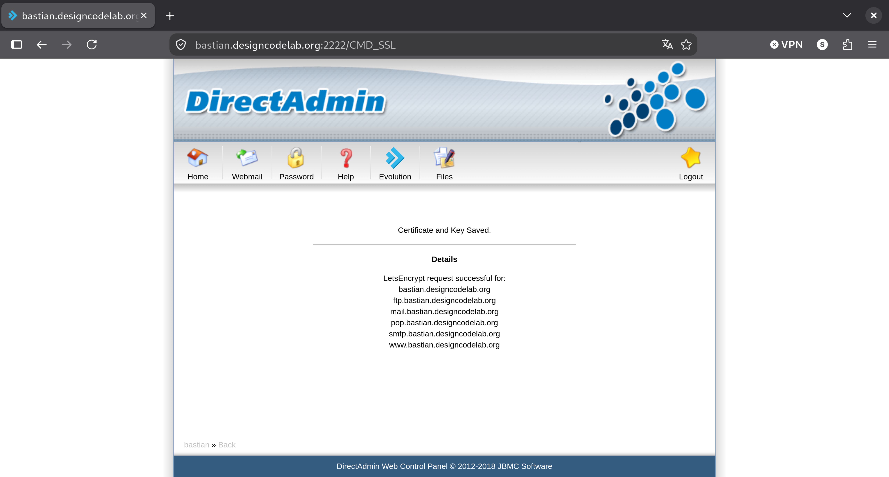

----

## Oefening

Vraag in je `Wordpress cursus` notebook in [Gemini AI](https://gemini.google.com)
```
Waarom heb ik een SSL-certificaat
nodig voor mijn site
```

---

# Installeren van WordPress 

Ga naar [WordPress Manager](#naar-het-beheer) via je bladwijzer

----

## WordPress Manager


----

## Start installatie

Nadat je op `Install` hebt geklikt zie je
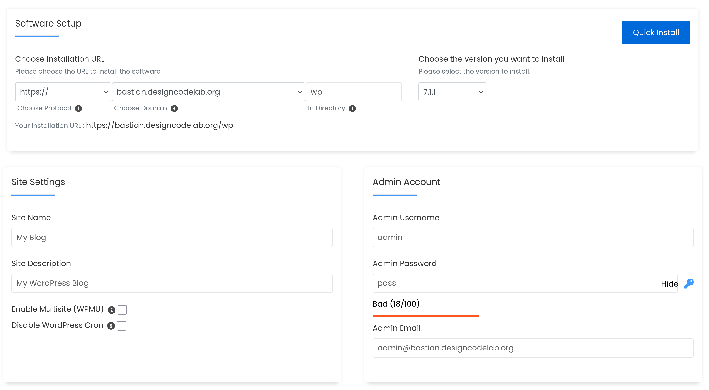

----

## Admin Account

Vul als `Admin Username` iets anders dan `admin` in.
Klik op het sleuteltje om een wachtwoord te genereren
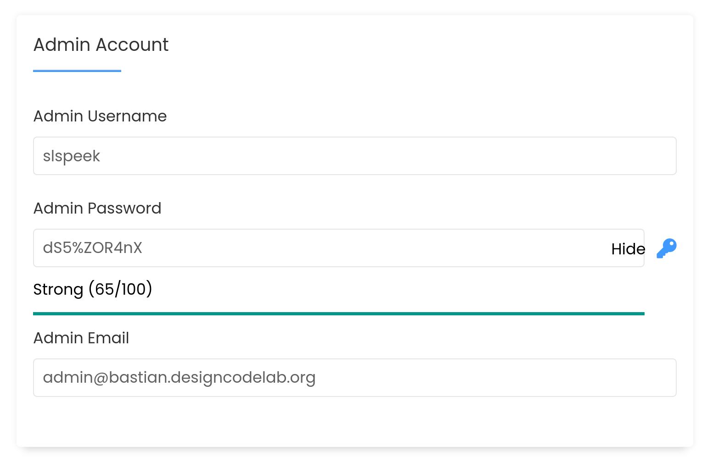

----

## Installeren

Nadat je de `Admin Account` gegevens hebt overgenomen,
druk je ondereen op `Install`
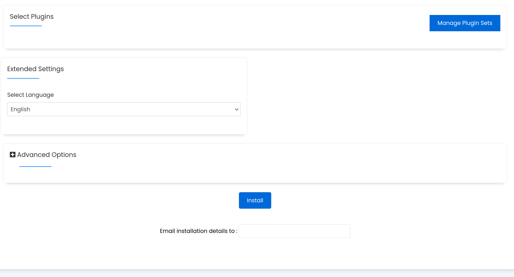


----

## Voortgang
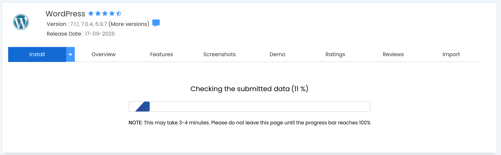

----

## Installatie voltooid
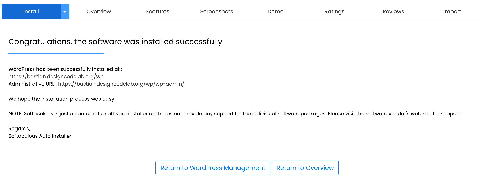

----

## Nieuwe site
Als de link naar je nieuwe site hebt geklikt zie je
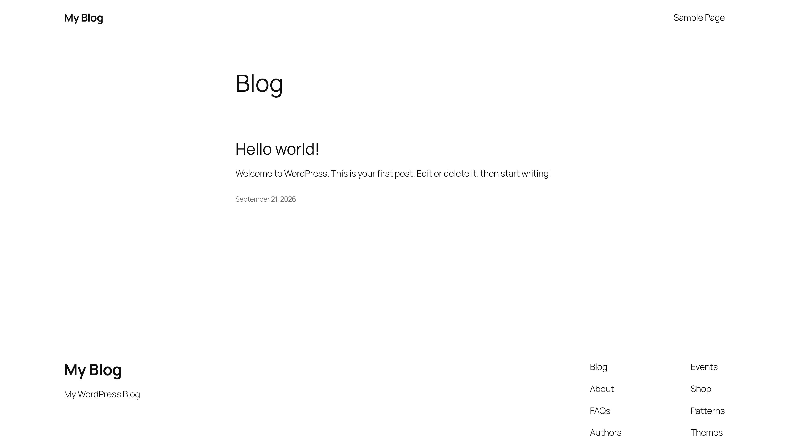

----

## Oefening

Bekijk de videoles

[WordPress essentials: Domains and hosting](https://learn.wordpress.org/lesson/wordpress-essentials-domains-and-hosting/)

----

## Oefening

Voer bestaand installatie procedé uit

---

# Inloggen op je Dashboard

- Ga naar je WordPress manager met behulp van je bladwijzer
- Klik op de `Login` knop van je site
- Maak hier een bladwijzer van <kbd><kbd>Ctrl</kbd>+<kbd>D</kbd></kbd>, geef het de naam `Dashboard`

---

# Themes

Hiermee bepaal je de opmaak van je site

----

## Soorten themes

1. [Block themes](https://wordpress.org/documentation/article/block-themes/)
2. Klassieke themes

----

## Oefening

Vraag aan je `Wordpress cursus` notebook in [Gemini AI](https://gemini.google.com)
```
waarom is het beter om een
block theme te gebruiken
```

----

## Oefening

Bekijk de videoles

[Choosing and installing a theme](https://learn.wordpress.org/lesson/choosing-and-installing-a-theme/)

----

## Oefening

Zet het theme van jouw site op 
[Twenty Twenty-four](https://wordpress.org/themes/twentytwentyfour/)
- Ga naar je `Dashboard` (bladwijzer)
- Kies links `Appearance` → `Themes`
- Activeer `Twenty Twenty-four`

En bekijk je site

----

## Oefening
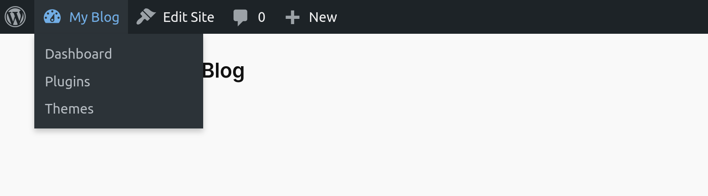
- Open dit menu door je muis boven `My Blog` te houden
- Kies het menuitem `Themes`
- Activeer `Twenty Twenty-five`

---

# Dashboard

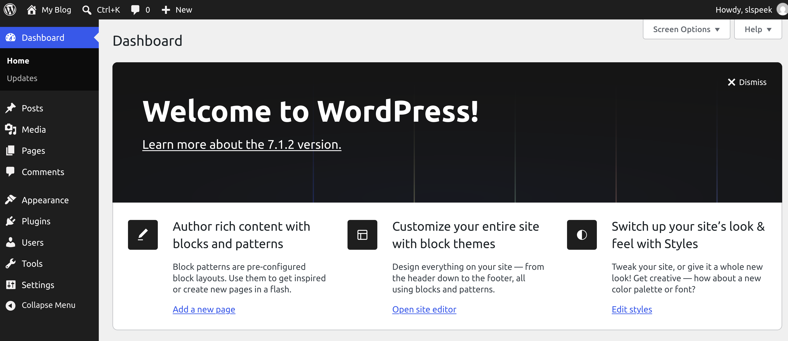

Vanuit hier beheer je je site

----

## Onderdelen

- Admin bar
- Administrative widgets
- Linker zijbalk

----

## Admin bar

Van links naar rechts:
- Links naar `wordpress.org`
- Wisselen tussen site en dashboard
- Comments
- New menu
- Profiel

----

## Oefening

Ga naar je dashboard met je bladwijzer
- Ga met 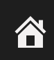 naar je site
- Maak een bladwijzer onder de naam `site` in het mapje `cursus` (<kbd><kbd>Ctrl</kbd>+<kbd>D</kbd></kbd>)

----

## Oefening

Ga terug naar het dashboard 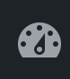 (linksboven op de Admin bar)

----

## Oefening

Houd je muis boven de + in de Admin bar, en kies `Post`. Verander de titel in `Eerste post` en klik in de body om daar `Mijn eerste post!` in te typen.

----

## Resultaat

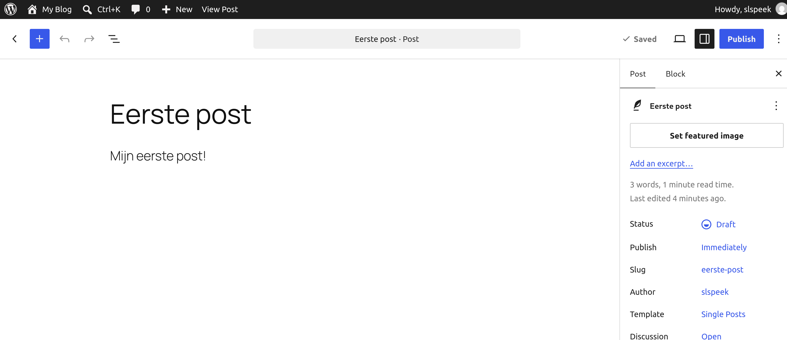

----

## Oefening

Ga naar je site met . Je `Eerste post` is niet te vinden. 

----

## Oefening

Klik in het dashboard in de linker zijbalk op `Posts`
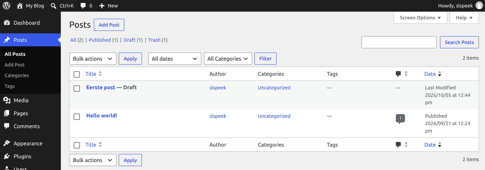

----

## Oefening

Klik op de link van je post. Klik dan op de `Publish` knop rechtsboven. Klik nogmaals op `Publish` te bevestiging. Ga naar je site en overtuig jezelf ervan dat je post er staat.

----

## Oefening

Bekijk de videoles

[Getting started with the WordPress dashboard](https://learn.wordpress.org/lesson/getting-started-with-the-wordpress-dashboard/)

----

## Oefening

Voer de zes stappen van praktische gedeelte uit.

---

# Posts vs Pages

----

## Pages

- Contact
- Over ons
- Voorwaarden/Juridisch

----

## Posts

- Nieuws
- Recepten
- Blog-posts

----

## Categories 

- Een post kan in meerdere categorieën zitten
- Er is een standaard categorie 
- Categorieën kunnen genest zijn

----

### Categorie aanmaken

In het dashboard op de linker zijbalk
onder `Posts` → `Categories`

----

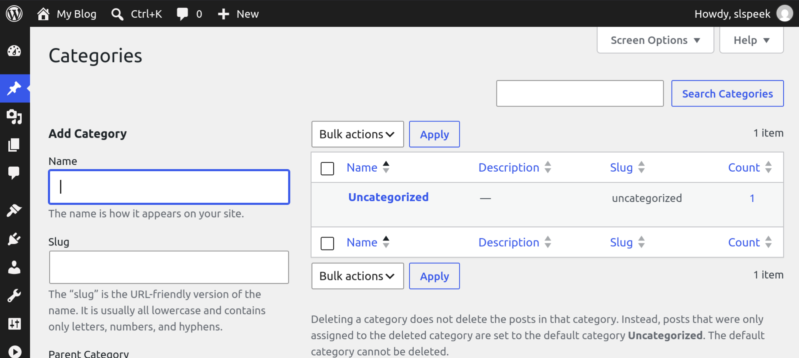

----

### Categorie slug

Korte naam van de categorie zonder spaties. Met letters, cijfers liggend streepje of het minteken.

----

## Oefening

Maak de categorie `Belangrijk` aan

----

## Oefening

Maak `Belangrijk` de `Default post category`. Ga op de linker zijbalk onder `Settings` naar `Writing` en selecteer uit dropdown `Belangrijk`
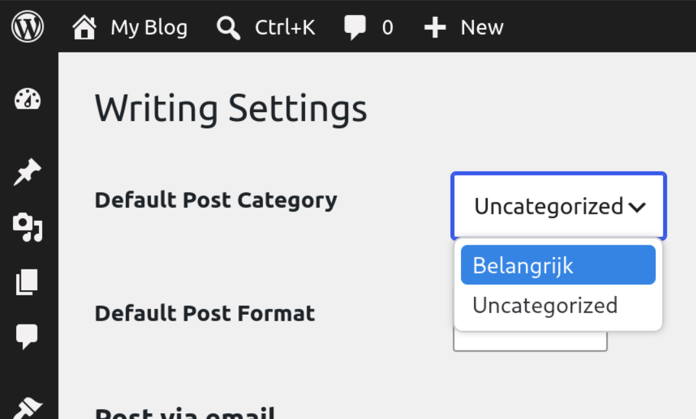

----

## Oefening

- Maak drie categorieën `Nederland`, `Utrecht` en `Noord-Holland`
- Maak `Nederland` de parent van de andere twee

----

## Oefening

- Maak een post voor in de categorie `Utrecht` en één voor `Noord-Holland`

----

## Oefening

Vraag aan het `Wordpress cursus` notebook in [Gemini AI](https://gemini.google.com)
```
Hoe maak ik een pagina waar de bezoeker
een categorie kan kiezen
```
Voer de instructies uit

----

## Tags

- Een post kan meerdere tags hebben
- Tags kunnen **niet** genest geworden

----

## Pages

- Kunnen geen categorieën of tags hebben
- Komen standaard in een menu in de header

----

## Oefening

 Bekijk de videoles 

 [Understanding the difference between WordPress posts and pages](https://learn.wordpress.org/lesson/understanding-the-difference-between-wordpress-posts-and-pages/)

 En voer de vijf praktische stappen uit


